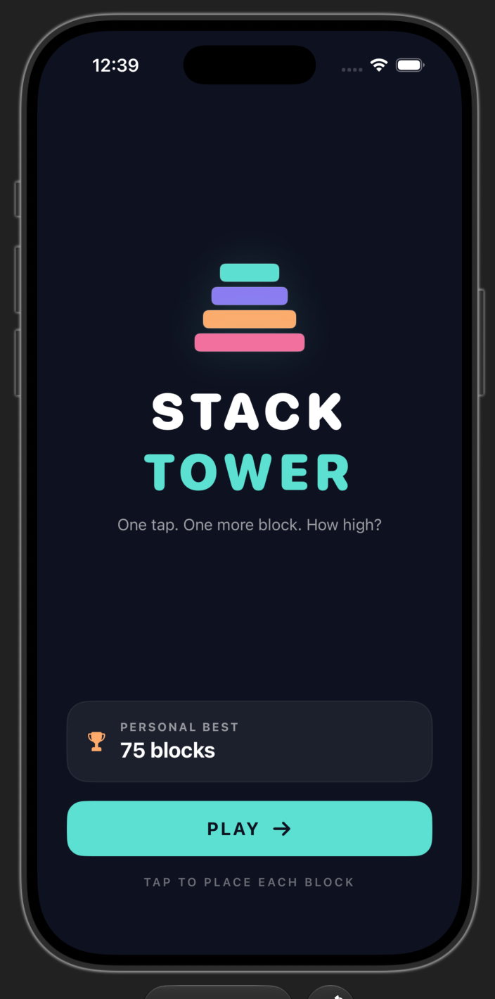
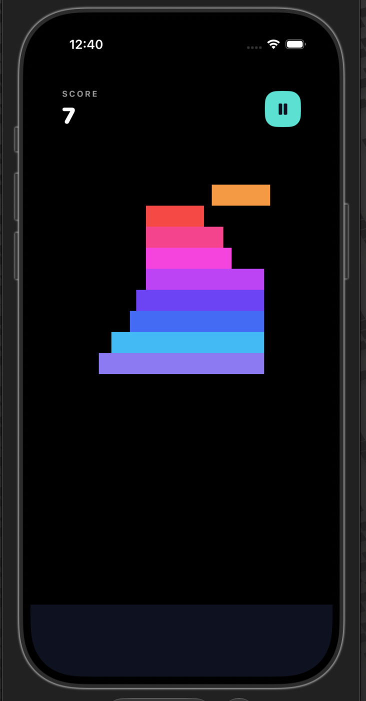
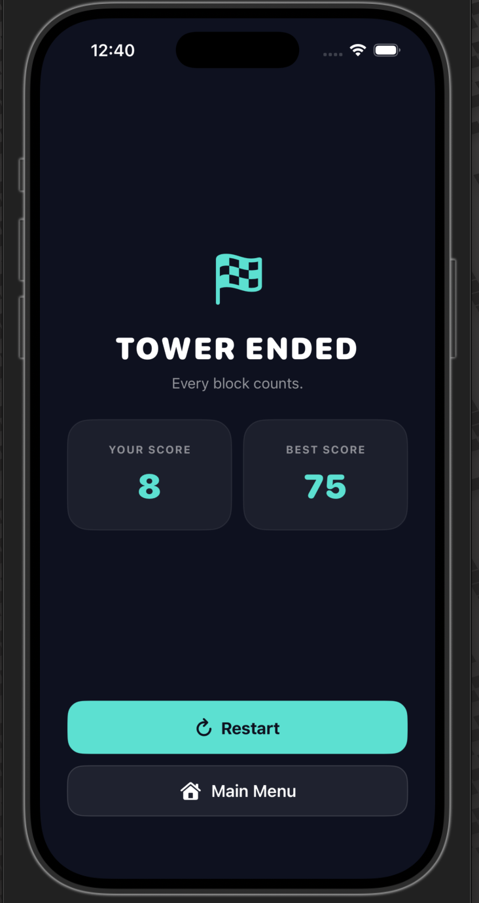

# <p align="left">
  
  <h1>SlackTree — Stack Tower</h1>
  <p><strong>A minimal hyper-casual stacking game for iOS.</strong></p>
  <p>One tap. One more block. How high?</p>
</p>

<br clear="left" />

Built with SwiftUI and SpriteKit. Tap to drop moving blocks, trim any overhang, and build the tallest tower you can.

**Repository:** https://github.com/nitnawareanshuman/SlackTree-iOS

## Features

- **One-tap gameplay:** Tap the screen to drop the moving block.
- **Overlap trimming:** Only the overlapping portion of a block remains. A miss ends the run.
- **Perfect drops and combos:** Near-perfect alignment snaps to the block below and awards bonus points. Consecutive perfect drops increase the combo.
- **Progressive difficulty:** Block movement speed increases as the tower grows, with a configurable maximum.
- **Camera follow:** A SpriteKit camera smoothly follows the active block as the tower grows.
- **Minimal, dynamic palette:** Blocks cycle through colours generated in code, avoiding external gameplay art assets.
- **Visual and tactile feedback:** Falling overhang pieces, a brief perfect-drop flash and particle effect, system sounds, and haptics.
- **Persistent best score:** The high score is stored locally using `UserDefaults`.
- **Performance-minded scene:** Movement uses elapsed frame time, old off-screen blocks are culled, and temporary effect nodes remove themselves after animations.
- **SwiftUI interface:** Menus, HUD, and game-state presentation are separated from SpriteKit gameplay.
- **Portrait-first experience:** Designed for iOS 16 and later.

## Technology Stack

- **Swift 5.9+**
- **SwiftUI** for menus, HUD, and app presentation
- **SpriteKit** for real-time gameplay
- **SpriteView** to host the SpriteKit scene inside SwiftUI
- **UserDefaults** for local best-score persistence
- **UIKit system feedback** for haptics and sounds

## Architecture

```text
SlackTreeApp
    |
    v
ContentView (SwiftUI)
    |  Menu and app-level presentation
    v
GameView (SwiftUI)
    |  HUD and SpriteView
    |                         ^
    | Creates / hosts scene   | GameSceneDelegate callbacks
    v                         |
GameScene (SpriteKit)
    |-- Block movement and placement
    |-- Overlap trimming and perfect-drop detection
    |-- Combo scoring and difficulty scaling
    |-- Camera follow and off-screen node cleanup
    |-- HapticsManager / SoundManager feedback
    |
    v
GameViewModel (ObservableObject)
    |-- Score, best score, combo, game state
    |-- Receives scene events and updates the SwiftUI UI
    v
HighScoreStore
    |  UserDefaults wrapper

Shared support:
Theme             -> Colour palette and gameplay constants
HapticsManager    -> Haptic feedback
SoundManager      -> System sound feedback
```

### Design principles

- **Separation of concerns:** `GameScene` handles gameplay, while SwiftUI owns the interface and HUD.
- **Explicit communication:** A `GameSceneDelegate` communicates score, combo, and game-over events to the view layer.
- **Centralized tuning:** `Theme` stores gameplay and visual constants so balancing changes do not require hunting through the scene code.
- **Resource cleanup:** Placed blocks below the camera cutoff are removed. Temporary visual effects clean themselves up after their SpriteKit actions finish.
- **Local persistence:** `HighScoreStore` keeps the best score across app launches.

## Getting Started

### Requirements

- A Mac with Xcode installed
- An Xcode version compatible with the project's installed iOS SDK
- iOS 16 or later as the deployment target
- An Apple Developer account for TestFlight distribution

### Run in the iOS Simulator

1. Clone the repository:

   ```bash
   git clone https://github.com/nitnawareanshuman/SlackTree-iOS.git
   cd SlackTree-iOS
   ```

2. Open `SlackTree.xcodeproj` in Xcode.
3. Select the `SlackTree` scheme.
4. Select an iPhone Simulator as the run destination.
5. Press **Run** (`⌘R`).

### Run on a physical iPhone

1. Connect the iPhone to your Mac and trust the computer if prompted.
2. Select the device in Xcode's run-destination menu.
3. Open the app target's **Signing & Capabilities** settings.
4. Select your own Apple Developer Team and make sure the bundle identifier is unique to your team.
5. Run the app on the device and test touch controls, haptics, sounds, camera movement, restarting, and high-score persistence.

If code signing fails, check the selected Team, bundle identifier, and provisioning settings before archiving.

## Controls

- **Tap:** Drop the moving block.
- **Accurate alignment:** A perfect drop snaps to the block below and increases the combo.
- **Miss:** Ends the run; restart from the game-over interface.

## Screenshots

Replace these placeholders with screenshots captured from the current build. Create a `Screenshots` folder in the repository and add the corresponding PNG files.

| Menu | Gameplay | Game Over |
|---|---|---|
|  |  |  |

*The image paths above are placeholders until the screenshots are committed.*

## Performance Notes

Block movement is based on elapsed frame time rather than a fixed distance per frame. The main `update(_:)` loop focuses on scalar calculations and position updates. Movement bounds and speed are recalculated when a block is spawned, rather than every frame. Old placed blocks are removed after passing below a camera-relative cutoff, while temporary effect nodes remove themselves after their animations.

FPS and node-count overlays are controlled by the debug setting in `Theme`. The game configures a 60 FPS target, but that setting is a target rather than a guarantee. Use Xcode Instruments on a physical device to inspect frame pacing, allocations, and memory behaviour.

## Assignment Deliverables

- Working iOS Simulator build or TestFlight build
- Source repository: https://github.com/nitnawareanshuman/SlackTree-iOS
- Half-page design note covering genre, art direction, and one technical challenge
- A 2–4 minute game walkthrough recorded and uploaded to Google Drive

## License

No license has been specified yet. Unless you add a license, do not assume that others have permission to redistribute or reuse this project.
